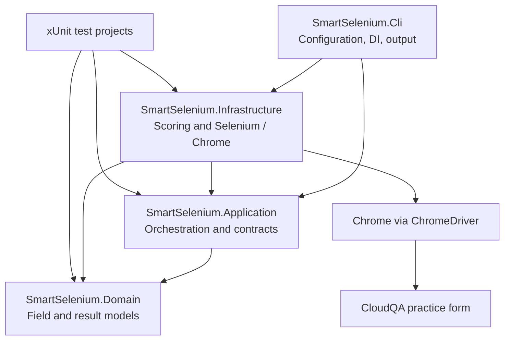

# SmartSelenium

SmartSelenium is a .NET 8 command-line application that uses Selenium WebDriver
to automate three controls on the CloudQA practice form: First Name, Gender,
and State. It combines browser interaction with heuristic candidate scoring so
the automation can use more than a single fixed field ID.

The project is a focused automation example, not a general-purpose or
redesign-proof locator platform. It currently supports Chrome and native HTML
form controls.

## What it does

- Opens the configured practice-form URL in Chrome.
- Scores candidate `input`, `select`, and `textarea` elements using control
  type, semantic tokens, selected attributes, visibility, and enabled state.
- Enters and verifies a First Name value.
- Selects and checks a Gender radio option.
- Selects and verifies a State option in a native HTML dropdown.
- Writes browser and candidate-selection information to the console through
  Microsoft.Extensions.Logging.

The candidate scoring is heuristic. It is not a probability estimate and
cannot guarantee correct field selection after arbitrary page changes.

## Technology stack

| Technology | Use |
|---|---|
| C# / .NET 8 | Application language and target framework |
| Selenium WebDriver 4.30 | Browser control and DOM interaction |
| Chrome / ChromeDriver | Browser and WebDriver implementation |
| Microsoft.Extensions.Configuration | JSON and environment-variable configuration |
| Microsoft.Extensions.DependencyInjection | Application composition and service registration |
| Microsoft.Extensions.Logging | Console logging |
| xUnit / FluentAssertions | Automated tests and assertions |

## Architecture

The solution is split by responsibility. The CLI composes the services and
starts the run; application contracts separate the workflow from Selenium;
Infrastructure contains the browser-specific implementation; Domain contains
field, candidate, and result models.



`AutomationOrchestrator` delegates to `IFormAutomationService`. The CLI
registers the Selenium-backed implementations through dependency injection.
The current browser factory always creates Chrome; the `BrowserType` setting
does not select another browser.

## Repository structure

```text
SmartSelenium.sln
src/
  SmartSelenium.Domain/          Field models, candidate data, domain errors
  SmartSelenium.Application/     Requests, interfaces, orchestration
  SmartSelenium.Infrastructure/  Chrome session, scoring, field interactions
  SmartSelenium.Cli/             Configuration, dependency registration, runner
tests/
  SmartSelenium.Domain.Tests/        Domain model tests
  SmartSelenium.Application.Tests/   Orchestration test
  SmartSelenium.Infrastructure.Tests/ Scoring and candidate ranking tests
  SmartSelenium.IntegrationTests/    Skipped CloudQA integration placeholder
  TestFixtures/                      Placeholder project; no shared fixture yet
config/
  appsettings.example.json       Example settings copied to CLI output
docs/
  architecture.md                Short architecture notes
  ENGINEERING_LEARNING_GUIDE.md  Detailed engineering concepts and caveats
.github/workflows/ci.yml         Restore, build, and test workflow
```

The principal implementation is in `src/SmartSelenium.Infrastructure/
SeleniumAutomationServices.cs`; it contains the browser factory/session,
candidate scorer, locator engine, and form automation service.

## Prerequisites

- .NET 8 SDK.
- Google Chrome installed and available to the account running the application.
- Network access to the configured site for a real CloudQA run.

Selenium's driver management may download or resolve a compatible ChromeDriver
when needed. The first run may therefore require network access. The CI
workflow builds and runs the current tests on Ubuntu, but it does not install
Chrome or execute a browser-based test.

## Installation

From a fresh clone, run these commands from the repository root:

```powershell
git clone https://github.com/chirannnn/smart-selenium-automation.git
Set-Location .\smart-selenium-automation

dotnet --version
dotnet restore .\SmartSelenium.sln
dotnet build .\SmartSelenium.sln --configuration Release --no-restore
```

The installed SDK should report version 8.x. The CLI project links
`config/appsettings.example.json` into its build output as `appsettings.json`.
No separate configuration-copy command is needed. Edit that example before
building if you want to change the bundled run settings; alternatively, use
environment variables as shown below.

## Configuration

`config/appsettings.example.json` is the configuration file included in the
CLI output. Its current values are:

| Setting | Example value | Meaning |
|---|---|---|
| `TargetUrl` | CloudQA practice form URL | Page to open |
| `FirstName` | `John` | Text to enter |
| `Gender` | `Male` | Radio option to select |
| `State` | `Argentina` | Native select option value or text |
| `Browser:BrowserType` | `Chrome` | Descriptive setting; the factory currently always creates Chrome |
| `Browser:Headless` | `true` | Add Chrome's `--headless=new` argument when true |
| `Browser:PageLoadTimeoutSeconds` | `30` | WebDriver page-load timeout |
| `Browser:ElementWaitSeconds` | `15` | Used to set an implicit wait to half this value, with a one-second minimum |
| `Browser:ConfidenceThreshold` | `0.75` | Currently loaded but not used by candidate selection |

The `BrowserSettings` defaults in code are Chrome, headless mode enabled, a
30-second page-load timeout, a 15-second element-wait setting, and a 0.75
confidence threshold. The bundled JSON file overrides those defaults when it
contains values; the checked-in example enables headless mode.

Configuration is loaded from `appsettings.json`, optional
`appsettings.Development.json`, and then environment variables. Environment
variables use double underscores for nested keys, such as
`Browser__Headless`.

### Important command-line precedence

The CLI parses `--url`, `--first-name`, `--gender`, and `--state`, but those
values are used only as fallbacks. Because the bundled `appsettings.json`
contains non-empty values, configuration normally wins over those flags.
`Microsoft.Extensions.Configuration.CommandLine` is referenced but no
command-line configuration provider is added. Use environment variables or
edit the example configuration to reliably override the bundled values.

## Run the application

The following PowerShell example uses environment variables, which take
precedence over the bundled JSON settings:

```powershell
$env:TargetUrl = "https://app.cloudqa.io/home/AutomationPracticeForm"
$env:FirstName = "John"
$env:Gender = "Male"
$env:State = "Argentina"
$env:Browser__BrowserType = "Chrome"
$env:Browser__Headless = "true"
$env:Browser__PageLoadTimeoutSeconds = "30"
$env:Browser__ElementWaitSeconds = "15"
$env:Browser__ConfidenceThreshold = "0.75"

dotnet run --project .\src\SmartSelenium.Cli\SmartSelenium.Cli.csproj --configuration Release
$runExitCode = $LASTEXITCODE

Remove-Item Env:TargetUrl, Env:FirstName, Env:Gender, Env:State,
    Env:Browser__BrowserType, Env:Browser__Headless,
    Env:Browser__PageLoadTimeoutSeconds, Env:Browser__ElementWaitSeconds,
    Env:Browser__ConfidenceThreshold -ErrorAction SilentlyContinue

if ($runExitCode -ne 0) {
    throw "SmartSelenium exited with code $runExitCode."
}
```

To run with the bundled configuration, use:

```powershell
dotnet run --project .\src\SmartSelenium.Cli\SmartSelenium.Cli.csproj --configuration Release
```

To run headed, set `Browser__Headless` to `false` in the environment or set
`Browser:Headless` to `false` in the configuration file.

### Parsed command-line arguments

The CLI recognizes the following flag/value pairs:

| Argument | Configuration fallback | Built-in fallback |
|---|---|---|
| `--url` | `TargetUrl` | CloudQA practice form URL |
| `--first-name` | `FirstName` | `John` |
| `--gender` | `Gender` | `Male` |
| `--state` | `State` | `Argentina` |

For example:

```powershell
dotnet run --project .\src\SmartSelenium.Cli\SmartSelenium.Cli.csproj -- --url "https://example.test/form" --first-name "Sam" --gender "Female" --state "Texas"
```

With the included non-empty JSON settings, this command's values are fallback
values and generally will not override the JSON. Prefer environment variables
for overrides until command-line precedence is changed.

## Output and exit codes

The application prints a summary and one line per field. A successful run
resembles:

```text
Result: Automation completed successfully.
- firstName: SUCCESS -> 'First Name' value 'John' applied and verified.
- Gender: SUCCESS -> Gender 'Male' selected and verified.
- State: SUCCESS -> State 'Argentina' selected and verified.
```

Informational and warning logs may appear before these lines, including browser
startup and candidate-selection diagnostics. Exact confidence scores and log
messages depend on the target page.

The CLI returns exit code `0` when the returned automation summary reports
success and `1` when it reports a failed field. Browser, navigation, locator,
or other exceptions are not converted into that summary and may terminate the
process with an unhandled exception.

## Tests

Run the automated test projects from the repository root:

```powershell
dotnet test .\SmartSelenium.sln --configuration Release --verbosity minimal
```

Current test coverage is focused and limited:

- **Domain tests:** alternative-label and keyword deduplication, normalized
  name, and success/failure result factories.
- **Application tests:** the orchestrator delegates once and returns the
  expected stubbed field results.
- **Infrastructure tests:** a First Name candidate reaches the asserted score
  and evidence is present; a State candidate outranks a Country candidate for
  the provided sample data.
- **Integration tests:** the CloudQA flow test is marked `Skip` because it
  requires a browser and network access. Its current body is a placeholder;
  it does not automate the site.
- **Template tests:** the remaining `UnitTest1.cs` tests have no meaningful
  assertions.

The CI workflow restores, builds, and runs tests on .NET 8. It does not collect
coverage reports or run a live browser test. A passing test run therefore does
not demonstrate that the complete CloudQA interaction works in every browser
environment.

## Locator design

`SeleniumLocatorEngine` discovers native form controls using the CSS query
`input, select, textarea`. `DefaultCandidateScorer` adds weighted evidence for
control type, overlapping normalized tokens, certain identity attributes,
placeholder and ARIA matches, visibility, and enabled state. The locator
engine applies minimum scores and raises an ambiguity exception when its
top-candidate comparison indicates close alternatives.

This approach is useful when one attribute changes but other field semantics
remain. It is deliberately heuristic: the implementation does not read
associated visible `<label>` elements, inspect parent/sibling context, query
custom controls, or implement multiple discovery strategies. It also builds
the final CSS selector from candidate ID, name, or tag, so candidate ranking
does not guarantee the follow-up selector uniquely identifies that candidate.
The configured confidence threshold is not currently connected to the
selection calls; their thresholds are hard-coded per field.

## Limitations and possible improvements

- Only Chrome and native `input`, `select`, and `textarea` controls are
  supported.
- The browser type setting is not used to select a browser.
- Candidate discovery reads a limited set of attributes and does not resolve
  visible label associations or nearby DOM context.
- The selected Gender candidate is scored but the interaction uses a separate
  CSS query. Radio verification can accept a matching value without confirming
  that the matching radio is selected.
- The state and First Name interaction paths verify selected/input values, but
  dynamic options are not awaited with explicit condition-based waits.
- The implementation uses an implicit wait; it does not implement explicit
  waits, stale-element recovery, screenshots, retries, or browser log capture.
- The configured confidence threshold is read but not used; the field-specific
  thresholds are constants in the service.
- The automation service stores its browser session in mutable instance state
  and is registered as a singleton. This is not suitable for concurrent runs.
- The navigation call occurs before the `try/finally` cleanup block, so a
  navigation exception may bypass session disposal.
- The live integration test is skipped, and the CI workflow does not launch a
  browser.

Potential next steps include exact candidate-to-element binding, explicit
waits for control readiness and dynamic options, strict selected-state
verification for radio buttons, a local HTML integration fixture, and richer
failure diagnostics. These are improvements, not capabilities claimed by the
current implementation.

## Development

For local development, restore, build, and test with:

```powershell
dotnet restore .\SmartSelenium.sln
dotnet build .\SmartSelenium.sln --configuration Release --no-restore
dotnet test .\SmartSelenium.sln --configuration Release --no-build --verbosity minimal
```

Keep changes scoped to the relevant layer and add tests for behavior that can
be verified deterministically. Browser-dependent tests should state their
environment requirements and should not be represented as passing end-to-end
coverage when skipped.

For deeper engineering discussion and a glossary, see the
[Engineering Learning Guide](docs/ENGINEERING_LEARNING_GUIDE.md). The shorter
[architecture notes](docs/architecture.md) provide additional project context.
