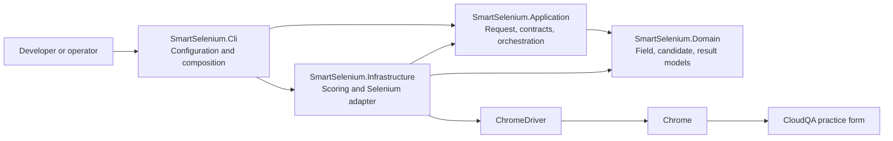

# Architecture

SmartSelenium is a .NET 8 command-line application for automating the First
Name, Gender, and State controls on the CloudQA practice form. Its project
boundaries separate the domain vocabulary, application contracts, Selenium
implementation, and command-line composition.

## System context



The CLI is the composition root: it reads settings, registers concrete
implementations, creates an `AutomationRequest`, invokes the orchestrator, and
prints the result. Application-level abstractions keep the workflow contracts
separate from Selenium classes. Infrastructure supplies the actual Chrome
session and field-interaction behavior.

## Projects and responsibilities

| Project | Responsibility | Main concepts |
|---|---|---|
| `SmartSelenium.Domain` | Framework-independent field and result vocabulary. | `FieldDefinition`, `LocatorCandidate`, `CandidateScore`, `FieldInteractionResult`, domain exceptions. |
| `SmartSelenium.Application` | Use-case request/settings models and contracts for browser, locator, and automation services. | `AutomationRequest`, `BrowserSettings`, `IAutomationOrchestrator`, `IBrowserSession`, `IElementLocator`, `IFormAutomationService`. |
| `SmartSelenium.Infrastructure` | Selenium/Chrome integration, candidate scoring and ranking, and form interactions. | `SeleniumBrowserFactory`, `SeleniumBrowserSession`, `DefaultCandidateScorer`, `SeleniumLocatorEngine`, `SeleniumFormAutomationService`. |
| `SmartSelenium.Cli` | Configuration loading, dependency registration, execution, and console output. | `Program.Main` and the Microsoft.Extensions configuration, DI, and logging providers. |

The project references point inward for application policy: Application
references Domain; Infrastructure references Application and Domain; CLI
references the projects it composes.

## Execution flow

```text
CLI arguments / JSON / environment
                 |
                 v
        AutomationRequest
                 |
                 v
  AutomationOrchestrator.RunAsync
                 |
                 v
  SeleniumFormAutomationService
       |         |          |
       v         v          v
   First Name  Gender     State
       \         |          /
        SeleniumBrowserSession
                 |
           ChromeDriver
                 |
              Chrome
```

The form service creates the browser session, navigates to the target, and
executes the three field operations. Each operation asks the locator engine
for candidates, selects one according to its score and the field-specific
minimum, performs an interaction, and checks the resulting value/state.
`ExecuteAsync` disposes the session in a `finally` block around the field
operations.

## Locator approach

The locator engine currently has one candidate-discovery query:
`input, select, textarea`. The Selenium adapter reads a fixed set of attributes
and element properties. `DefaultCandidateScorer` adds heuristic points for
control type, overlapping normalized tokens, certain attributes, placeholder
and ARIA matches, visibility, and enabled state. `SeleniumLocatorEngine`
applies a caller-provided minimum score and can throw when its top candidates
are too close.

The score is a heuristic, not a calibrated probability. Although the
application contracts include `ILocatorStrategy`, the current locator engine
does not compose multiple strategy implementations. It does not resolve
associated visible labels, inspect parent/sibling text, or support custom
controls. After scoring, the form service constructs a CSS selector from
candidate ID, name, or tag; this means the final action is not always uniquely
bound to the exact candidate that was scored.

## Architectural choices and boundaries

- **Dependency inversion:** Application defines interfaces; Infrastructure
  implements them; CLI selects implementations.
- **Dependency injection:** `Program.Main` registers the browser factory,
  scorer, locator, form service, and orchestrator.
- **Selenium isolation:** Domain and Application do not reference Selenium
  browser types. Infrastructure owns `IWebDriver` and `SelectElement`.
- **Focused scope:** The implementation uses Chrome and native HTML inputs,
  radios, and selects. `BrowserType` is modeled/configured but the factory
  always creates Chrome.

This is a small layered application, not a complete general-purpose
automation platform. The application orchestrator currently delegates to the
form service; browser-specific settings and field operations are concentrated
in Infrastructure. The form service is registered as a singleton while
holding a mutable session field, so the current composition is intended for a
single CLI run, not concurrent automation runs.

## Key implementation references

- [CLI startup and configuration](../src/SmartSelenium.Cli/Program.cs)
- [Application models and interfaces](../src/SmartSelenium.Application/AutomationModels.cs)
- [Application orchestration](../src/SmartSelenium.Application/AutomationOrchestrator.cs)
- [Domain models](../src/SmartSelenium.Domain/FieldModels.cs)
- [Selenium and locator implementation](../src/SmartSelenium.Infrastructure/SeleniumAutomationServices.cs)

For detailed explanations of the engineering concepts and current limitations,
see the [Engineering Learning Guide](ENGINEERING_LEARNING_GUIDE.md).
